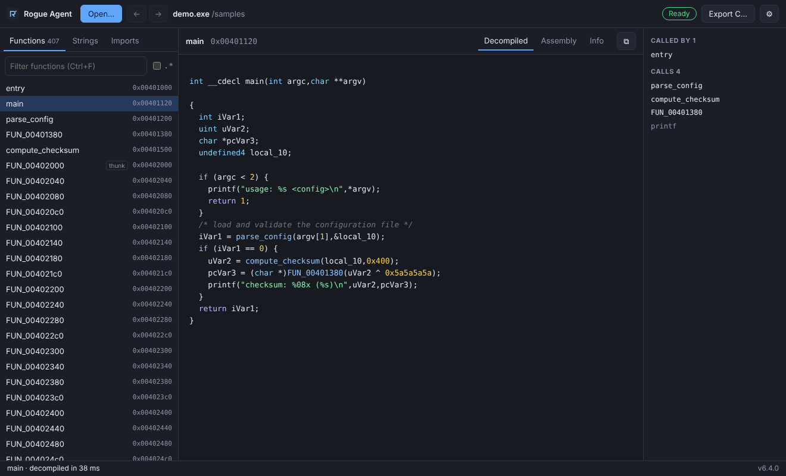

# Rogue Agent

A fast, simple Windows decompiler built on [Ghidra](https://github.com/NationalSecurityAgency/ghidra)
and the [REA](https://github.com/morluto/rea) analysis engine.

Open an `.exe`, `.dll` or ELF file and browse its functions, decompiled C,
assembly, strings, imports and call graph in one clean window. The analysis
runs locally. The same engine is also an MCP server, so coding agents can
investigate binaries too.



## Install

1. Download `RogueAgent-<version>-Setup-x64.exe` (or the portable `.zip`) from
   the latest CI run or release. It installs per user, with no admin rights.
2. Start **Rogue Agent** and open a binary.

Ghidra 12.1.4 and the Eclipse Temurin JDK 21 come with the app, in its
`ghidra` and `jdk` folders. They are private copies: nothing is installed
system-wide, and your own Java or Ghidra is left alone. To use your own
Ghidra or JDK instead, choose its folder in **Settings**; clear the field to
go back to the bundled one. The bundled Ghidra omits its documentation,
optional extensions, source archives and non-Windows binaries, none of which
analysis uses. The installer is about 380 MB and the portable zip about 480 MB.

Windows 10 1809 or newer and the Microsoft Edge WebView2 Runtime are required.
WebView2 is preinstalled on Windows 11. Without it, Rogue Agent offers to run
in your browser instead.

## Use

- **Open** a binary with the button, by dropping it on the window, from the
  recent list, or with **Open with → Rogue Agent** in Explorer. Ghidra imports
  and analyzes it once, and reopening the same file later skips the analysis.
  Every view reuses that warm session.
- **Navigate** with the virtualized function, string and import lists. Filter
  them instantly, optionally with a regex.
  - Every call in the decompiled C is a link.
  - Alt+← and Alt+→ go back and forward.
  - Selecting a string or import shows which functions use it.
- **Views:** decompiled C, assembly, function info, and callers and callees.
- **Export C…** decompiles every function into one `.c` file, in parallel.

Keyboard: Ctrl+O to open, Ctrl+F to filter, Ctrl+Shift+E to export,
Alt+←/→ for history, ↑/↓ in the function list.

## Speed compared with upstream REA

CI runs the same requests through both engines with Ghidra 12.1.4 on
GitHub-hosted 4-core runners. The target is a SQLite 3.54 shell built for
Windows (1.8 MB, 2,505 functions). The table gives Rogue Agent's speed relative
to upstream (above 1× is faster) over two CI runs of the same commit. Both
engines produced identical pseudocode for all 136 sampled functions.

| Measurement                            | Linux                          | Windows                          |
| -------------------------------------- | ------------------------------ | -------------------------------- |
| First open (import and auto-analysis)  | 0.9–1.0×                       | 1.0–1.1×                         |
| Reopen the same binary                 | 16–18× (128–135 s → 7.5–7.9 s) | 11–16× (112–176 s → 10.1–11.1 s) |
| 120 functions requested at once        | 1.0–1.2×                       | 1.0–1.2×                         |
| 16 largest functions requested at once | 1.4–1.6×                       | 1.3–1.5×                         |
| One function at a time                 | 0.9–1.1×                       | 1.0–1.3×                         |
| Resolve a function by name             | 3.1–5.9×                       | 2.6–3.9×                         |

Every CI run publishes its own table in the step summary of the **Real
Ghidra** jobs in the [CI workflow](.github/workflows/ci.yml). Runner speed
varies a lot between runs, especially on Windows: upstream's first open took
114 s in one run and 180 s in the other. Compare the two engines within one
run.

| Change                        | Effect                                                                                                                                                                                                                                                                              |
| ----------------------------- | ----------------------------------------------------------------------------------------------------------------------------------------------------------------------------------------------------------------------------------------------------------------------------------- |
| Cross-session analysis cache  | The first open stores Ghidra's analyzed program, verified by SHA-256. Reopening the same binary imports it with `-noanalysis` instead of importing and analyzing again. This applies to the app, the CLI and MCP alike.                                                             |
| Parallel decompile windows    | Pseudocode requests that are queued together, such as `batch_decompile`, export, or prefetching callees, are decompiled as one window. A pool of Ghidra decompilers, one per core up to eight, is kept for the session. Each request still gets its own result.                     |
| Decompile cache in the bridge | Decompiled text is kept per function until the program changes, so one window serves every request queued behind it.                                                                                                                                                                |
| Indexed name lookup           | Resolving a function by name was a scan over every function and its entry symbols. It is now one hash lookup.                                                                                                                                                                       |
| Host-sized JVM                | The heap is 25% of RAM (2–16 GB) instead of Ghidra's fixed 2 GB, so large binaries have room. GC and JIT threads scale with the core count. This also applies on Windows, through `analyzeHeadless.bat`. On the benchmark binary with four cores it makes no measurable difference. |
| Decompile timeout             | `REA_GHIDRA_DECOMPILE_TIMEOUT_SECONDS` (default 120 s in the app) stops one pathological function from wedging the session.                                                                                                                                                         |
| Background callee prefetch    | After you open a function, its callees are decompiled in one window, so the next click usually hits the cache.                                                                                                                                                                      |
| Lean desktop runtime          | The UI server is ready in about 150 ms and loads the engine in the background. A bundled runtime keeps the module count low for Windows startup.                                                                                                                                    |

Costs:

- Each pooled decompiler is a native process. On the benchmark binary each
  one held about 100 MB, for the whole session.
- A session reopened from the cache starts with a cold JVM, so its first
  decompiles are somewhat slower than in a session that just finished
  analysis.
- Parallel windows gain most on large functions. For short functions the
  JVM side of Ghidra's decompiler does most of the work.

## Agents and the command line

The installed folder contains `rea.cmd`, the full REA CLI and MCP server,
running on the bundled Node runtime:

```powershell
& "$env:LOCALAPPDATA\Programs\Rogue Agent\rea.cmd" mcp      # stdio MCP server
& "$env:LOCALAPPDATA\Programs\Rogue Agent\rea.cmd" --help
```

Register it with any MCP client as a local stdio server. See
[MCP contracts](docs/mcp-contracts.md), [CLI](docs/cli.md) and
[installation](docs/installation.md) for the engine's tools and settings.

## Build from source

The engine needs Node.js 24 (see `.nvmrc`), and the window needs Rust. The Windows package can
be built on Linux with MinGW-w64:

```bash
npm ci
npm run build                      # engine, MCP server, desktop server
npm run desktop                    # run the UI in a browser against local Ghidra
npm run build:windows-native       # Windows native add-on (Linux + MinGW)
rustup target add x86_64-pc-windows-gnu
(cd desktop/launcher && cargo build --release --target x86_64-pc-windows-gnu)
node scripts/desktop/package-windows.mjs --zip   # out/RogueAgent-<version>-win-x64.zip
```

On Windows, `iscc desktop/packaging/RogueAgent.iss` builds the installer from
`out/RogueAgent-win-x64`. CI does all of this on every pull request. See
[CONTRIBUTING](CONTRIBUTING.md#windows-desktop-app) for the layout.

| Path                                 | Contents                                                            |
| ------------------------------------ | ------------------------------------------------------------------- |
| `src/`, `bridge/`                    | The REA analysis engine and its Ghidra bridge (TypeScript and Java) |
| `src/desktop/`, `src/desktopMain.ts` | Desktop server: settings, discovery, warm session, HTTP API         |
| `desktop/ui/`                        | The UI (HTML, CSS and JavaScript, no framework)                     |
| `desktop/launcher/`                  | `RogueAgent.exe`: Rust, WebView2 and a Job Object                   |
| `desktop/packaging/`                 | Inno Setup installer script                                         |
| `scripts/desktop/`                   | Packaging, end-to-end test and benchmark scripts                    |

## Relationship to REA

Rogue Agent is a fork of [morluto/rea](https://github.com/morluto/rea) at
`2895a18`. It keeps REA's engine, tools and tests. It drops REA's website,
translations, release tooling and experiments, and adds the speed changes above
plus the Windows app. Deep native analysis needs Ghidra (or IDA through
ida-pro-mcp), which you install yourself.

## Responsible use

Use Rogue Agent for lawful research, interoperability, security work and
analysis of software you own or are authorized to examine. See
[DISCLAIMER.md](DISCLAIMER.md).

## License

[MIT](LICENSE). REA-authored code is MIT-licensed by its authors. Third-party
material keeps its own licenses; see [THIRD_PARTY_NOTICES.md](THIRD_PARTY_NOTICES.md)
and [licenses/](licenses/). The Windows package also redistributes the Node.js
runtime (MIT, with its bundled third-party licenses) and the Microsoft WebView2
loader.
